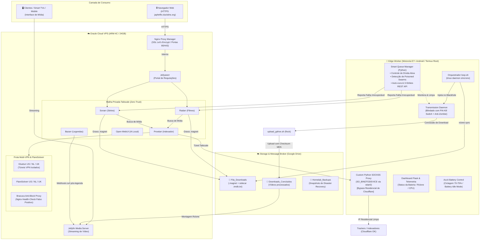

# 🛡️ Zero-Trust Hybrid Homelab & Edge Automation

<p align="center">
  
  
  
  
  
  
</p>

---

## ⚡ Resumo Executivo (TL;DR)

O **Japheflix Homelab** é uma infraestrutura de automação de mídia e edge computing distribuída em **3 nós**, desenhada sob uma arquitetura **Zero Trust** e de consumo ultrabaixo de energia:

1. **☁️ Nuvem (Oracle Cloud VPS ARM 4C/24GB):** Orquestrador central rodando Docker Compose com túneis VPN multi-região, microsserviços de indexação (*arr stack), streaming (Jellyfin) e reverse proxy com SSL Let's Encrypt.
2. **📱 Borda (Motorola E7+ Android / Termux Root):** Nó *headless* 24/7 responsável pelos downloads P2P pesados, gestão preditiva de espaço em disco, auto-cura de torrents corrompidos e atuando como um **Proxy Residencial SOCKS5** com chamadas de socket a nível de kernel (`SO_BINDTODEVICE`) para contornar bloqueios anti-bot do Cloudflare.
3. **☁️ Barramento de Armazenamento (Google Drive 5TB via Rclone):** Ponte desacoplada que sincroniza filas de download (blackhole), armazena a biblioteca de mídia montada na VPS e retém snapshots semanais de disaster recovery.

> 💡 **Engenharia Assistida por IA (Vibecoding):**  
> Todo o design da arquitetura, depuração de rede de baixo nível, scripts de kernel Android, pipelines de auto-cura e automação de disaster recovery foram concebidos e implementados colaborativamente utilizando **técnicas de Vibecoding com Gemini no Google Antigravity 2.0**.

---

## 📋 Especificação dos Nós da Infraestrutura

| Nó | Hardware / SO | Conectividade | Papel Principal |
|:---|:---|:---|:---|
| 🖥️ **Oracle Cloud VPS** | ARM Ampere (4 vCPU / 24GB RAM) • Ubuntu Linux | IP Público (Portas 80/443) + Tailscale Mesh (`100.x.x.x`) | Orquestração Docker: Radarr, Sonarr, Prowlarr, Bazarr, Jellyfin, Jellyseerr, Nginx Proxy Manager, 3× Gluetun VPNs, Open-WebUI. |
| 📱 **Worker Android (Edge)** | Motorola E7 Plus (Octa-Core / 4GB RAM / 39GB HD) • Android 10 (Root / Termux) | Wi-Fi Residencial + PIA VPN (Kill Switch) + Tailscale Userspace | Downloader Transmission, Proxy Residencial SOCKS5, Smart Queue Manager (Python), Dashboard Flask de Telemetria. |
| ☁️ **Storage Broker** | Google Drive (5TB Cloud Storage) | API Rclone Multithread | Ponte desacoplada de dados: `Fila_Downloads` (.magnet), `Downloads_Concluidos` (mídia), `Homelab_Backups` (snapshots). |
| 💻 **PC Local (Cliente/WOL)** | Desktop Intel i7 • Ubuntu Linux | Rede Local Ethernet / Tailscale | Consumo de mídia sob demanda, Wake-on-LAN via socket direto no Android e servidor HTTP (`pc-remote.py`) para desligamento remoto. |

---

## 🏗️ Topologia da Arquitetura



---

## ⚡ Diferenciais Técnicos & Inovações de Engenharia

### 1. 🛡️ Segurança Zero Trust & Isolamento de Portas
- **Superfície de Ataque Mínima:** Nenhuma porta administrativa (7878, 8989, 9696, 6767, 3000) é exposta para a internet pública na VPS da Oracle.
- **Isolamento de Redes:** Todas as ferramentas de gestão são vinculadas exclusivamente aos IPs virtuais `100.x.x.x` da malha privada **Tailscale**. Apenas as portas `80` e `443` estão abertas para o mundo, roteadas pelo **Nginx Proxy Manager** com certificados SSL automáticos Let's Encrypt para o domínio `japheflix.duckdns.org`.

---

### 2. 🌐 Proxy Residencial SOCKS5 com `SO_BINDTODEVICE` (Bypass de Cloudflare)
- **O Desafio:** Os IPs de datacenters da Oracle Cloud e VPNs comerciais sofrem bloqueios severos de anti-bot do Cloudflare (Erro 403) ao consultar sites e indexadores torrent.
- **A Solução:** Um proxy SOCKS5 customizado em Python roda como root no celular Android (`socks5.py`). Utilizando a chamada de socket de baixo nível no kernel Linux `SO_BINDTODEVICE` associada à interface física `wlan0`:
  - O proxy "fura" o Kill Switch da VPN ativa no aparelho e encaminha as requisições do Prowlarr/FlareSolverr diretamente pela conexão de banda larga residencial.
  - Para os indexadores, as buscas partem de um usuário residencial comum, eliminando 100% dos bloqueios de Cloudflare.

---

### 3. 🌍 Frota Multi-VPN & Roteamento por Tags no Prowlarr
- **3 Túneis VPN Independentes:** O `docker-compose.yml` gerencia 3 instâncias isoladas do Gluetun com seus respectivos FlareSolverrs:
  - `gluetun-us` + `flaresolverr-us` (Estados Unidos)
  - `gluetun-nl` + `flaresolverr-nl` (Holanda)
  - `gluetun-uk` + `flaresolverr-uk` (Reino Unido)
- **Roteamento Dinâmico:** Os indexadores no Prowlarr são taggeados individualmente (`proxy-us`, `proxy-nl`, `proxy-uk` ou `proxy-residencial`). Se um provedor internacional bloquear determinada região, basta alternar a tag no painel sem reiniciar nenhum container.
- **Minisservidor Anti-Bloqueio Nginx (`brazuca-proxy`):** Intercepta checagens de saúde do Prowlarr para feeds específicos de séries que falham em requisições sintéticas, respondendo com falso-positivo para manter o status sempre verde sem interferir nas buscas reais.

---

### 4. 🧠 Smart Queue Manager & Auto-Cura de Torrents (`queue_manager.py`)
- **Gestão de Dívida Ativa:** Como o nó de borda conta com apenas 39GB de disco, o daemon Python calcula o espaço livre real (`df -k`) e cruza com o tamanho pendente de todos os downloads ativos (*dívida ativa*). Se a soma ultrapassar a margem de segurança de 4GB, os downloads excedentes sofrem pausa instantânea.
- **Congelamento de Torrents Travados (*Stalled*):** Torrents sem atividade ou seeds há mais de 5 minutos são congelados temporariamente, devolvendo orçamento de disco para downloads saudáveis da fila.
- **Detector de Poisoned Swarms (Redes Corrompidas):** O script analisa a proporção de dados brutos (`downloadedEver` vs `haveValid`). Se um download receber > 200MB de dados mas descartar 5x mais dados corrompidos do que os gravados no disco (com < 10% concluído), é classificado como *Poisoned Swarm* (ataques de poluição ou honeypots).
- **Política de 3 Strikes & Auto-Cura:**
  - *Strikes 1 e 2:* O script purga os dados locais corrompidos, extrai o Magnet Link original via RPC e re-injeta o torrent para forçar uma nova seleção de peers saudáveis.
  - *Strike 3:* O script dispara uma requisição HTTP via proxy Tailscale para a API REST do Radarr/Sonarr, cruza o hash com o histórico (`eventType=grabbed`), marca o release como falho (`/api/v3/history/failed/{id}`), coloca o hash na blocklist e força a busca autônoma de um release alternativo.

---

### 5. 🎯 Engenharia de Pontuação de Qualidade & Idiomas (TRaSH Guides Híbrido)
- **Quebra da "Ditadura do 4K":** No Radarr e Sonarr, as resoluções foram mescladas em um único grupo aceito. Isso impede que arquivos 4K gigantes vençam arquivos 1080p bem compactados por padrão.
- **Desempate por Resolução:** Custom Format `Tiebreaker: Alta Resolução (1080p+)` valendo `+1` ponto (desempata apenas quando tamanho e idioma forem rigorosamente iguais).
- **Matemática Superior de Tamanhos:**
  - *Perfil Pessoal:* Pontuações na casa dos milhares (`+5000` para ideal, `-5000` para pesados) para calibrar com o Recyclarr.
  - *Perfil Família:* Pontuações na casa das dezenas (`+40` a `+50` para ideais, `-500` para pesados).
  - *Bloqueio Letal:* Releases > 20GB recebem `-20000` pontos.
- **Blindagem de Dublagens Nacionais:** O indexador injeta tags no título Cardigann (`torrentio.yml`). O Custom Format `Brazuca Groups / Trackers` (`+1000` pontos) somado a `DUAL` (`+1000` pontos) atinge `+2000+` pontos, garantindo a prioridade absoluta de releases dublados limpos sobre falsos dual-audios gringos.
- **Proteção do Armazenamento Móvel no Sonarr:** Bloqueio de Season Packs gigantes (>20GB) com a regra `Lixo: Maior que 20GB (Celular)` (`-20000` pontos), forçando o download em cascata episódio a episódio (limitados a max 100 MB/min).
- **Webhook Instantâneo no Bazarr:** Custom Post-Processing com `curl` acionando a API do Jellyfin no exato segundo em que uma legenda é salva.
- **Prevenção de Banimento da API do Google Drive:** Monitoramento em tempo real desativado no Jellyfin para evitar erros 403 Rate Limit, utilizando apenas Webhooks disparados pelos orquestradores ao concluir downloads.

---

### 6. 🔋 Otimização de Hardware 24/7 & Kernel Android
- **Segurança Térmica com AccA (Root):** O módulo de controle de carga AccA foi configurado para ciclar a bateria entre 70% e 75% (`pause_capacity=75`, `resume_capacity=70`). Isso ativa o **Battery Idle Mode**, onde a energia da tomada alimenta diretamente o processador, evitando estufamento e degradação da bateria ao operar 24/7.
- **Isolamento de Redes no Android:** A PIA VPN opera via Android VpnService nativo com Kill Switch ("Block connections without VPN"). O Tailscale roda paralelamente em modo userspace (`--tun=userspace-networking --socks5-server=localhost:1055`), contornando a limitação nativa do Android de 1 VPN por vez.
- **Wrapper Anti-Zumbi do Transmission:** Script transparente em `/data/data/com.termux/files/usr/bin/transmission-daemon` que executa `kill -9` em instâncias órfãs na memória antes de iniciar novos daemons.
- **Desempenho de Peers sem Sobrecarga de Roteador:** Limite de 1000 conexões globais no Transmission. Como todo o tráfego passa encapsulado pelo túnel criptografado `tun0` da VPN, o roteador residencial enxerga apenas 1 conexão contínua, sem estourar tabelas NAT.
- **Uploads Sequenciais com `flock` & Validação MD5:** O script `upload_gdrive.sh` utiliza um lock de arquivo (`flock $HOME/upload.lock`) para enfileirar uploads pesados via Rclone multithread (`--transfers=4`). O arquivo local só é excluído após confirmação do **Checksum MD5** e tamanho exato junto à API do Google Drive.
- **Sala de Espera (Staging Area) & Bypass de Cache RAM:** O `worker.sh` injeta carimbos de data Unix Epoch nos nomes dos arquivos `.magnet`, permitindo que o Transmission baixe repetidamente mídias com o mesmo nome sem travas em seu cache de memória RAM.

---

### 7. 🔄 Pipeline de Rastreio com Sidecars (Blackhole TMDB Tracking)
- **O Desafio:** Em setups de Blackhole via Google Drive, o Radarr/Sonarr apenas salva o `.magnet` e não recebe o InfoHash de volta imediatamente.
- **A Solução:**
  1. No *Grab*, scripts no Radarr/Sonarr geram arquivos sidecar com o ID do TMDB/TVDB (ex: `Filme.2025.tmdb.txt`).
  2. O worker no Android intercepta o par de arquivos, calcula o **InfoHash Base32** diretamente do `.magnet` e renomeia o arquivo para `<HASH>.tmdb.txt` na pasta `mappings/`.
  3. A API do dashboard Flask lê essa pasta e injeta `"tmdbId": "..."` no JSON de telemetria, permitindo que clientes e dashboards pareiem mídias com 100% de precisão.

---

### 8. 💻 Automação e Controle Remoto do PC Local
- **Wake-on-LAN via Socket Direto (`wol-pc.py`):** Envio de Magic Packet através da interface física `wlan0` no Android (usando `SO_BINDTODEVICE` para furar a VPN), ligando o computador desktop pela rede local.
- **Mini Servidor HTTP no PC (`pc-remote.py`):** Servidor Python rodando como serviço de usuário systemd (porta 9876), expondo endpoints para `/status`, `/shutdown` e `/hibernate` integrados ao dashboard mobile.
- **Discrição com GDM Blanking:** Configuração no display manager (`greeter.dconf-defaults`) para apagar os monitores na tela de login em 30 segundos durante inicializações remotas.

---

### 9. 🚨 Disaster Recovery em < 15 Minutos (Snapshots Automatizados)

| Componente | Agendamento | Conteúdo do Snapshot | Retenção | Procedimento de Restauração |
|:---|:---|:---|:---|:---|
| **☁️ Oracle VPS** | Diário às 04:00 (systemd timer) | Pasta `/home/ubuntu/configs` (Docker Compose, SQLite DBs, SSL NPM, Nginx) | 7 Dias | `tar -xzvf homelab_backup.tar.gz -C /home/ubuntu/` + `docker compose up -d` |
| **📱 Worker Android** | Semanal (Domingos às 03:00) | Raiz `/usr` e `/home` do Termux (scripts, binários, configs, SSH) | 30 Dias | Imagem Fantasma via `restore.sh` (ADB) ou `restore2.sh` (Termux) |

---

## 🤖 Engenharia com Vibecoding (Antigravity 2.0 + Gemini)

Este projeto foi integralmente concebido e desenvolvido utilizando o fluxo de **Vibecoding**:
- **Design e Modelagem Arquitetural:** Discussão iterativa de topologia de redes, segurança Zero Trust e orquestração de microsserviços.
- **Engenharia de Baixo Nível:** Desenvolvimento de scripts em Python utilizando flags de socket de kernel Linux (`SO_BINDTODEVICE`), manipulação de sysfs de bateria e criação de daemons no Android.
- **Resolução de Problemas Complexos:** Implementação de algoritmos de semáforo de disco, mitigação de vazamentos de memória e criação de bridges de API REST entre a borda e a nuvem.

---

## 📁 Estrutura do Repositório

```text
├── docker-compose.yml              # Orquestração de containers da VPS (NPM, Jellyfin, *arr, Gluetun, etc.)
├── .env.example                    # Template de variáveis de ambiente para a stack
├── .gitignore                      # Proteção de segredos, configs locais e documentação interna
├── app.py                          # Dashboard web (Flask) e API de telemetria do Edge Worker
├── socks5.py                       # Proxy Residencial SOCKS5 com SO_BINDTODEVICE (wlan0)
├── start-proxy.sh                  # Inicializador dos daemons Root (Proxy SOCKS5, Dashboard e Sysfs)
├── queue_manager.py                # Cérebro de alocação de disco, semáforo e detecção de poisoned swarms
├── worker.sh                       # Sincronizador de magnets/sidecars e resolvedor de InfoHash
├── loop.sh                         # Loop infinito do orquestrador de borda (executado via tmux)
├── upload_gdrive.sh                # Gatilho pós-download com lock sequencial (flock) e validação MD5
├── start_servers.sh                # Inicializador de todos os daemons e serviços do Worker
├── backup_termux.sh                # Automação de snapshot semanal do sistema Android
├── backup_openwebui.sh             # Backup dedicado da base de dados do Open-WebUI
├── restore.sh                      # Disaster Recovery Estratégia 1 (Restauração total via ADB shell)
├── restore2.sh                     # Disaster Recovery Estratégia 2 (Restauração rápida dentro do Termux)
├── wol-pc.py                       # Magic Packet Wake-on-LAN com bypass de VPN via wlan0
├── pc_client.py                    # Cliente HTTP para envio de comandos de energia para o PC
├── pc-remote.py                    # Mini servidor HTTP no PC local (porta 9876) para shutdown/status
├── pc-remote.service               # Unidade systemd para execução do servidor de controle no PC
├── wol-persist.service             # Unidade systemd para persistência de Wake-on-LAN antes do shutdown
├── greeter.dconf-defaults          # Configuração GDM para blanking automático de monitores em 30s
├── custom_formats.json             # Regras customizadas de qualidade e formatos de áudio/vídeo (Radarr)
├── quality_profiles.json           # Perfis de qualidade híbridos Radarr (Pessoal vs Família)
├── sonarr_custom_formats.json      # Regras customizadas de qualidade e formatos de áudio/vídeo (Sonarr)
├── sonarr_quality_profiles.json    # Perfis de qualidade híbridos Sonarr
└── templates/
    └── index.html                  # Interface moderna Glassmorphism do dashboard de telemetria
```

---

## 🚀 Como Executar

### 1. Pré-requisitos

- **☁️ Nuvem (VPS):**
  - Instância VPS (Oracle Cloud Free Tier ARM 4C/24GB ou Ubuntu 22.04+) com Docker e Docker Compose instalados.
  - Portas `80` e `443` abertas no firewall para o Nginx Proxy Manager.
- **📱 Borda (Edge Worker):**
  - Smartphone Android com acesso Root, Termux, Termux:Boot e Rclone instalados.
  - Módulo **AccA** (recomendado para controle térmico de bateria em 70–75%).
- **☁️ Armazenamento em Nuvem (Google Drive):**
  - Conta Google Drive (atuando como barramento de mensagens e storage desacoplado, eliminando a necessidade de grandes discos locais na VPS).
  - **Rclone** configurado com o remote chamado `gdrive:` tanto na VPS (para montagem contínua em `/home/ubuntu/GoogleDrive`) quanto no Android (para sincronização de magnets e upload de mídias).
- **🔒 Provedor de VPN Comercial:**
  - Assinatura com suporte a OpenVPN/WireGuard (ex: *Private Internet Access - PIA*, *Mullvad*, *ProtonVPN*).
  - **Na VPS:** Credenciais preenchidas no `.env` para os contêineres `gluetun` (túneis internacionais para os indexadores e FlareSolverr).
  - **No Android:** App da VPN rodando com a opção nativa de sistema *"Bloquear conexões sem VPN" (Kill Switch)* ativada para blindagem do tráfego P2P.
- **🌐 Rede Mesh (Zero Trust):**
  - Conta no **Tailscale** conectando a VPS (`100.x.x.x`), o Worker Android (via modo userspace) e seus dispositivos pessoais.

---

### 2. Configuração de Variáveis de Ambiente

Copie o template de exemplo e preencha suas credenciais reais (VPN, DuckDNS, Tailscale IPs, API Keys):
```bash
cp .env.example .env
nano .env
```

---

### 3. Montagem do Armazenamento (VPS)

Monte o Google Drive na VPS para que o Jellyfin e os gerenciadores (*arr) acessem a biblioteca de mídias:
```bash
mkdir -p /home/ubuntu/GoogleDrive
rclone mount gdrive: /home/ubuntu/GoogleDrive --vfs-cache-mode full --allow-other &
```

---

### 4. Inicialização da Stack na VPS

Com as portas da malha Tailscale parametrizadas e o Google Drive montado:
```bash
docker compose up -d
```

---

### 5. Inicialização do Edge Worker (Android / Termux)

No ambiente Termux do celular:
```bash
# Iniciar todos os daemons (SSHD, Tailscale Userspace, Transmission, Proxy SOCKS5 e Orquestrador)
bash start_servers.sh
```

---

## 📊 Dashboard de Telemetria & API

O nó de borda expõe um dashboard web responsivo com design *Glassmorphism* (acessível via Tailscale na porta `5000`):
- **Bateria & Hardware:** Nível percentual de carga, status de alimentação (Battery Idle Mode), temperatura, carga de CPU (`/proc/loadavg`) e uso de RAM.
- **Transmission & Rclone:** Torrents ativos, velocidade instantânea de download/upload, progresso percentual, ETA e status de integridade.
- **Controle de PC Local:** Botões integrados para Wake-on-LAN, Status, Hibernação e Desligamento remoto do computador desktop.
- **Logs de Backup:** Visualização dos últimos logs do snapshot semanal.

---

## 📄 Licença e Aviso Legal

Este projeto foi desenvolvido estritamente para **fins educacionais, pesquisa em redes distribuídas, automação de infraestrutura híbrida e exploração de desenvolvimento assistido por IA (Vibecoding)**.

Distribuído sob a licença MIT. Consulte `LICENSE` para mais detalhes.
